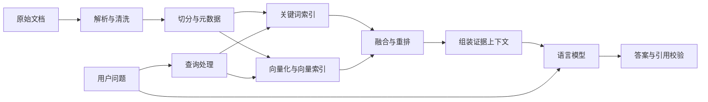

# 01｜RAG 原理与系统全貌

## 1. RAG 到底是什么

RAG 是 Retrieval-Augmented Generation，即检索增强生成：先从外部知识源找到与问题有关的材料，再把材料作为上下文交给生成模型。

例如用户问：“星河学习平台退款要在购买后多久申请？”

知识库中存在：

> 自购买之日起 7 个自然日内，且已学习课时不超过总课时的 10%，可以申请退款。

系统把这段文字和问题一起交给模型，模型组织回答并引用来源。模型没有因为这一次问答而更新权重；它是在当前上下文中使用材料。

RAG 原论文将检索到的外部知识与生成模型结合。今天工程中说的 RAG 范围更广，也包括关键词检索、数据库检索、多阶段排序等实现。见 [RAG 原论文](https://arxiv.org/abs/2005.11401)。

## 2. 一张图理解完整流程

无法渲染 Mermaid 时，按文字理解：文档→清洗→切分→索引；问题→检索→选择证据→生成→校验。

这条链路分成两个阶段：

| 阶段 | 何时执行 | 输入 | 输出 |
|---|---|---|---|
| 离线建库 | 首次导入或文档变化时 | 文档集合 | 文本块、元数据、索引 |
| 在线问答 | 每次提问时 | 问题和用户身份 | 证据、回答、引用 |

不要每次提问都重新给所有文档生成向量。文档向量通常预计算，在线阶段主要计算问题向量。

## 3. 六个核心组件

| 组件 | 职责 | 常见错误 |
|---|---|---|
| Loader / Parser | 读取文件并恢复结构 | PDF 双栏顺序混乱 |
| Chunker | 把长文拆成检索单位 | 条件与结论被切开 |
| Embedder | 将文本映射为向量 | 文档与查询使用不兼容模型 |
| Retriever | 找到候选证据 | 精确编号检索失败 |
| Reranker | 对候选精细排序 | 候选中根本没有正确证据 |
| Generator | 基于证据组织回答 | 添加材料中没有的承诺 |

向量数据库负责存储和搜索向量及元数据；通常不负责“理解全部文档后回答问题”。Embedding 模型生成向量；聊天模型生成回答。二者职责不同。

## 4. RAG、微调、长上下文与工具调用

| 方法 | 改变什么 | 适合什么需求 | 主要限制 |
|---|---|---|---|
| RAG | 每次提供的外部证据 | 知识经常更新、需要来源 | 依赖检索与数据质量 |
| 微调 | 模型参数或适配参数 | 输出风格、任务行为、领域模式 | 更新事实与删除知识不方便 |
| 长上下文 | 一次输入更多材料 | 文档数量少、需要全篇理解 | 成本、噪声、上下文利用率 |
| 工具调用 | 获取实时结果或执行操作 | 查订单状态、计算、查数据库 | 需要明确权限和接口约束 |

这些方法可以组合：用微调改善回答格式，用 RAG 提供知识，用只读工具查询订单实时状态。

例子：

- “退款政策是什么？”适合查政策文档。
- “我的订单现在是否退款成功？”应查询有权限访问的订单系统。
- “最近 30 天退款金额总计多少？”适合数据库聚合，不适合只找几段相似文字后猜总数。

## 5. 为什么 RAG 仍然会答错

沿链路逐层检查：

1. **知识缺失**：原始资料没有答案。
2. **解析损坏**：表格金额对应错了商品。
3. **切分损坏**：“仅限工作日”被分到另一块。
4. **召回失败**：答案存在，但候选中没有。
5. **排序失败**：正确块排在上下文预算之外。
6. **生成失真**：模型把“可以申请”说成“一定退款”。
7. **引用失真**：引用存在，但不支持紧邻的结论。

因此，检索结果与最终回答必须分开观察。只换更大的聊天模型，无法修复前几层的错误。

## 6. 一个严格的证据例子

资料 A：购买后 7 个自然日内可以申请退款。

资料 B：退款还要求学习进度不超过 10%。

问题：“买了 5 天，学了 20%，能退吗？”

如果只找到了 A，模型可能回答“可以”。完整回答需要 A 和 B：时间条件满足，但学习进度条件不满足。

这说明“找到一个相关块”与“找到足够回答问题的证据”不同。对多条件问题，要评估证据完整性。

## 7. 开始设计时先写四句话

1. 服务谁：个人学习者、客服、内部员工？
2. 回答什么：政策解释、技术排障、跨文档分析？
3. 证据来自哪里：哪些目录、系统、版本？
4. 什么情况下不能回答：资料缺失、权限不足、政策冲突？

本教程的定义是：帮助个人查询虚构平台的帮助文档；只回答材料支持的事实；提供文件与标题来源；材料不足时明确说明。

## 8. 本章自检

- 为什么修改知识库通常不需要重新训练聊天模型？
- 为什么只有搜索框与搜索结果列表还不构成完整的 RAG 问答？
- 为什么能够展示引用，也不能证明回答正确？

下一章：[环境搭建与第一个检索实验](02_环境搭建与第一个检索实验.md)。
